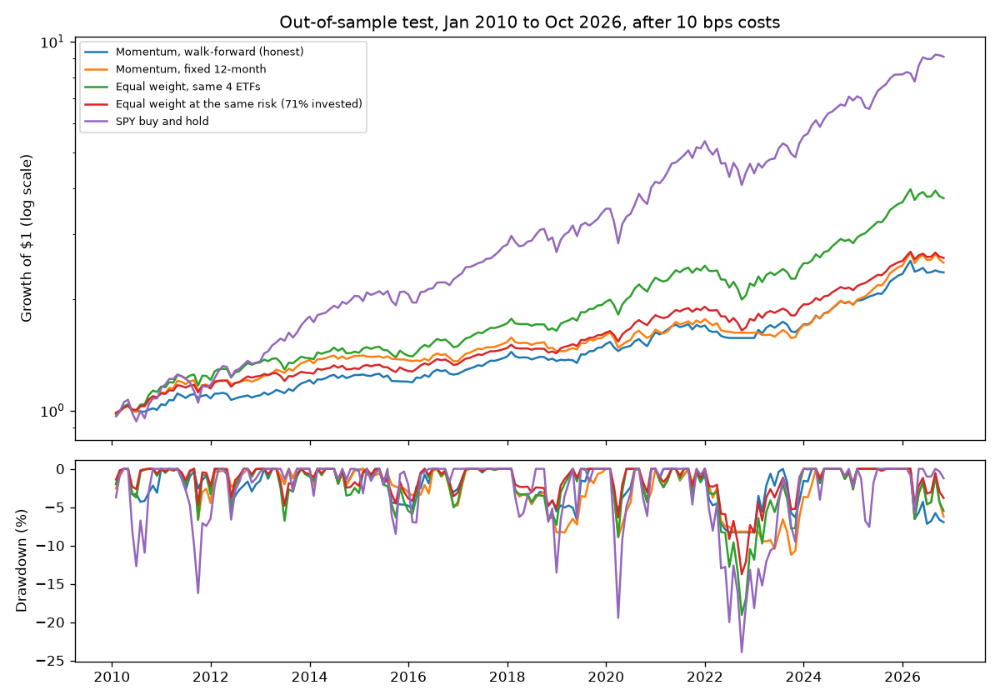

# Momentum Backtest: an honest test of a simple trading rule

Does a classic trend-following rule actually work once you test it properly?
This project backtests **time-series momentum** on four ETFs and tries hard
not to fool itself: no look-ahead, trading costs included, settings chosen
walk-forward, compared against fair baselines, and checked for luck with a
bootstrap.

**Short answer:** momentum cut the worst loss from −19% to −8%, but it earned
less, and its risk-adjusted return was no better than simply holding the same
ETFs at the same risk level. The drawdown protection is real; the "edge" isn't.



## The rule

- Assets: **SPY** (US stocks), **EFA** (international stocks), **IEF** (US bonds), **GLD** (gold).
- Each asset gets a fixed 1/4 slot. At each month-end, if the asset went up over
  the last *L* months, the slot holds it next month; otherwise the slot sits in cash.
- *L* (the lookback) is chosen from 1, 3, 6, 9 or 12 months.

## How it avoids fooling itself

| Trap | What this project does |
| --- | --- |
| **Look-ahead bias** (using tomorrow's prices today) | Positions decided at the close of month *t* only earn month *t + 1*. Tests rewrite future prices and check past decisions don't change. I planted two look-ahead bugs and the tests caught both. |
| **Overfitting the settings** | Walk-forward: for each year from 2010, the lookback is picked using only earlier years, then traded for that year. Every result month is out of sample. |
| **Ignoring costs** | 10 bps charged on every unit of turnover, plus a table at 0 / 10 / 25 / 50 bps. |
| **Weak baselines** | Compared against equal weight in the same ETFs, equal weight scaled to the **same volatility**, and SPY. |
| **Luck** | Paired block bootstrap (12-month blocks, 5,000 samples): how often does the strategy's Sharpe beat the baseline's? |
| **Dividends** | Adjusted closes, so returns are total returns. |

## Results (Jan 2010 to Oct 2026, 202 months, after 10 bps costs)

| Strategy | CAGR | Volatility | Sharpe | Max drawdown |
| --- | ---: | ---: | ---: | ---: |
| Momentum, walk-forward (honest) | 5.3% | 6.5% | 0.82 | −8.3% |
| Momentum, fixed 12-month | 5.6% | 7.0% | 0.81 | −11.2% |
| Momentum, best lookback in hindsight (3m) | 5.0% | 6.2% | 0.83 | −10.2% |
| Equal weight, same 4 ETFs | 8.2% | 9.2% | 0.91 | −19.1% |
| Equal weight at the same risk (71% invested) | 5.8% | 6.5% | 0.91 | −13.8% |
| SPY buy and hold | 14.0% | 14.3% | 0.99 | −23.9% |

Full output, including the lookback chosen each year and the cost table, is in
[results/summary.md](results/summary.md).

What I take from it:

1. **Lower risk is not the same as a better strategy.** Momentum sits in cash
   part of the time, so of course it's calmer. Scaled to the same volatility,
   plain equal weight earned more (5.8% vs 5.3%) with a higher Sharpe (0.91 vs 0.82).
2. **The drawdown benefit holds up.** Even against the same-risk baseline, the
   worst loss was smaller (−8.3% vs −13.8%). In 2022, when stocks and bonds fell
   together, the rule moved to cash.
3. **The Sharpe difference is not significant.** The strategy beat equal weight
   in only 24% of bootstrap samples (90% range of the difference: −0.30 to +0.12).
4. **Tuning barely mattered.** Walk-forward picked 6 months every year, and even
   the best lookback chosen with hindsight only reached a Sharpe of 0.83. A
   rule this simple doesn't have much to overfit.
5. **Costs matter.** At 1.9× turnover per year, Sharpe drops from 0.85 (free) to 0.65 at 50 bps.

## Limitations

- Monthly data, so drawdowns inside a month are not visible.
- Cash earns 0% and Sharpe uses a 0% risk-free rate. T-bills paid more than that
  for parts of this period, which would help the strategy a little.
- Only four ETFs and about 17 years of test data; one regime (2022) drives
  much of the drawdown difference.
- Costs count changes in target weights, not small rebalancing trades from price
  drift (this flatters the always-invested baselines slightly).

## Run it

```bash
python -m venv .venv && source .venv/bin/activate
pip install -r requirements.txt
python -m backtest.run --refresh   # downloads prices, writes results/
pytest -q                          # 11 tests, no internet needed
```

## Layout

| File | What it does |
| --- | --- |
| `backtest/data.py` | Downloads and caches daily adjusted prices, converts to month-end |
| `backtest/strategy.py` | Momentum and equal weights; turns weights into returns after costs |
| `backtest/walkforward.py` | Chooses the lookback year by year using only the past |
| `backtest/metrics.py` | CAGR, volatility, Sharpe, drawdown, and the block bootstrap |
| `backtest/run.py` | Runs everything and writes `results/` |
| `tests/` | Look-ahead, cost, metric and bootstrap tests on synthetic prices |

## Next steps

- Add a T-bill ETF as the cash asset instead of 0%.
- Run the strategy's orders through my C++ order book to model fills and slippage.
- Try more assets and daily data to see whether the conclusions hold.
